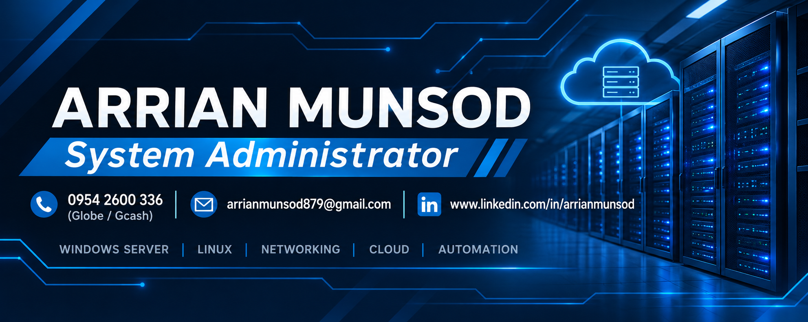

  

# 👨‍💼 Arrian Munsod

### System Administrator  
**0954 2600 336 (Globe / Gcash)**  
**arrianmunsod879@gmail.com**  
**www.linkedin.com/in/arrianmunsod**  
 
## 💻 Tech Stack / Skills:

 

  
 
-blue) 
-blue) 
 
 
 
 
 
 
 
 
  
 -blue) 
 
 
 
 
 
  
 
  
 
 
 
 
  
  
 
 
 
 
 
 
 
 
 
  
 
  
 
 
 

 
*
## AI-Assisted Development

I leverage AI tools to assist with code generation, research, troubleshooting, and technical documentation. All AI-assisted work is reviewed, tested, and refined before publication.
 
*

## 🅿️ PowerShell Scripts / Projects

### 1. Miscellaneous
- **[1.1. POWERSHELL CHEAT SHEET 💢 ❗](https://gist.github.com/arrianmunsod/fb31bd300ca4e1e48e04cb1f7b144de0)**
- **[1.2. Connecting PowerShell to a Remote Machine](https://gist.github.com/arrianmunsod/3c5b10840feb24e767c57e73be632eef)**
- **[1.3. Block All EXE Files in Folder and Subfolders Using Windows Firewall](https://github.com/arrianmunsod/block-all-exe-in-a-folder-using-windows-firewall)**
- **[1.4. Block Microsoft Office, Adobe Products, Autodesk Products from Connecting to the Internet Using Windows Firewall](https://github.com/arrianmunsod/block-exe-ms-autocad-adobe)**

 

## 📁 Windows Server Projects and Labs

### 2. Group Policy
- **[2.1. Auditing Folders And Files](https://gist.github.com/arrianmunsod/0fa0d96282a861c0695ec4d5603b80b4)**
 

## 📗📘 Microsoft Office and MS 365

- **[1. Microsoft Word - Automated Image Resizing Based on Table Cell Dimensions](https://github.com/arrianmunsod/microsoft-word-auto-resize-image)**
- **[2. Microsoft Excel Automation – Resize Images to Match Cell Size](https://github.com/arrianmunsod/microsoft-excel-auto-resize-image)**
- **[3. Excel to Word Auto-Fill Automation](https://github.com/arrianmunsod/ExcelToWordAutoFillAutomation)**
- **[4. Microsoft Word - Picture Insertion Automation](https://github.com/arrianmunsod/Microsoft-Word-Automated-Picture-Insertion)**
 

## 👨🏽‍💻 Linux Projects, Labs, Tutorials

### 1. Miscellaneous
- **[1.1. LINUX CHEAT SHEET 💢 ❗](https://gist.github.com/arrianmunsod/cc032a1f97d186f4a3c9b45aa2e4eae5)**
 

## 📑 Tutorials

- **[Reveal WiFi Passwords saved on your Windows 10/11 machine](https://gist.github.com/arrianmunsod/22b966ad1b4dfe38c8e27942f70702d9)**
 

## 📟 Miscellaneous

- **[HG8145V5 Default Username and Password](https://gist.github.com/arrianmunsod/b23246c0cfdb38e9ab34ad4df96859b9)**
 

## 🧑‍💼 Work History  

## Professional Experience

| Position / Company / Duration | Responsibilities & Achievements |
|---|---|
| **Technical Assistant** *Subcontractor – PH* Oct 2023 – Present | - Prepare Technical Site Survey Reports, AutoCAD drawings, and technical documentation for data center, power plant, and major energy and telecommunications projects, covering building layouts, network and electrical systems. - Assist with Globe Telecom equipment configuration, inspection, and troubleshooting, including DC power rectifiers and battery systems, as well as general IT support. |
| **Freelance IT Technician** *Freelance Contract Work – PH* 2010 – Present | - Provide IT support and technical services to personal clients, subcontractors, and small-to-medium businesses. |
| **IT Administrator** *Construction Firm – Makati City* Jun 2018 – Sep 2019 | - **IT Infrastructure Architecture & Modernization:** Architected and deployed Windows Server 2016/2019 Active Directory domain environments on VMware vSphere, replacing peer-to-peer networks with centralized client-server infrastructure. Modernized SOHO networks with managed switches, enterprise-grade routing, fiber connectivity, static public IPs, and Windows Server-based DHCP/DNS services. - **Systems Administration & Cloud Services:** Administered Windows Server, Active Directory, Microsoft Entra ID, Microsoft 365, and Google Workspace; managed user provisioning, account lifecycle, licensing, application access, Group Policy, and permissions. Implemented centralized file servers with VPN access and Active Directory authentication, managed FortiGate firewall policies, and maintained backup operations. - **IT Operations, Automation & Vendor Management:** Developed PowerShell automation for IT reporting, log generation, Microsoft 365 administration, and user management. Handled workstation assembly, troubleshooting, and IT equipment procurement; coordinated with vendors for computers, networking equipment, telecommunications, and biometric systems. |
| **Junior System Administrator** *Korean BPO Company – Makati City* Aug 2012 – Dec 2016 | - **Server & Virtualization Administration:** Configured and managed VMware vSphere environments and Windows Server instances; performed physical server, blade system, and rack component maintenance, OS installation, patching, updates, and troubleshooting. - **Systems Administration & IT Support:** Managed Active Directory accounts, Group Policy, folder permissions, user onboarding, and password resets; assisted with system imaging, backup and recovery verification, and troubleshooting network and server issues in collaboration with senior system administrators. - **Network & Infrastructure Management:** Configured Cisco switches, VLANs, ACLs, and network ports; performed structured cabling, RJ45 termination, patch panel installation, and wall outlet termination. Monitored network and server infrastructure. |

 

## 🎓 Education  

| 🎓 Degree | 🏫 Institution | 📅 Year |
|:--|:--|:--|
| **154 Semester Hours focused on System Administration, Cloud Computing, Networking in lower and upper baccalaureate** | American Council on Education (ACE) | 2021 – 2025 |
| **Bachelor of Science in Information Technology** | University of the East - Manila | 2006 – 2010 |

 

<h2 align="left">🧠 Completed certification curriculum (exam not pursued):</h2>

  <table>
    <tr>
      <th align="left">🧠 Title</th>
      <th align="center">🗓️ Date</th>
    </tr>
    <tr>
      <td align="left"><b>CompTIA Linux+ (XK0-005)</b></td>
      <td align="center">2025</td>
    </tr>
    <tr>
      <td align="left"><b>CompTIA Security+ (SY0-701)</b></td>
      <td align="center">2025</td>
    </tr>
    <tr>
      <td align="left"><b>CompTIA A+ (220-1101 and 220-1102)</b></td>
      <td align="center">2025</td>
    </tr>
    <tr>
      <td align="left"><b>CompTIA Server+ (SK0-005)</b></td>
      <td align="center">2024</td>
    </tr>
  </table>

*  

<h2 align="left">🧠 Other Self-paced Learning</h2>

  <table>
    <tr>
      <th align="left">🧠 Title</th>
      <th align="center">🗓️ Date</th>
    </tr>
    <tr>
      <td align="left"><b>Windows Server 2025 Essential Training</b></td>
      <td align="center">2026</td>
    </tr>
    <tr>
      <td align="left"><b>Skillsoft Aspire Journey - Windows Server 2022</b></td>
      <td align="center">2025</td>
    </tr>
    <tr>
      <td align="left"><b>Practical Windows PowerShell Scripting</b></td>
      <td align="center">2025</td>
    </tr>
  </table>

*  

<h2 align="left">🧠 Certifications (certification exam passed)</h2>

  <table>
    <tr>
      <th align="left">🧠 Title</th>
      <th align="center">🗓️ Date</th>
    </tr>
    <tr>
      <td align="left"><b>Pearson IT Specialist - Networking (INF-101)</b></td>
      <td align="center">2023</td>
    </tr>
    <tr>
      <td align="left"><b>VMWare Certified Technical Associate - Data Center Virtualization (VCTA-DCV)</b></td>
      <td align="center">2021</td>
    </tr>
    <tr>
      <td align="left"><b>CompTIA ITF+ Certified (FC0-U61)</b></td>
      <td align="center">2021</td>
    </tr>
    <tr>
      <td align="left"><b>Administering Windows Server Hybrid Core Infrastructure (AZ-800)</b></td>
      <td align="center">2022</td>
    </tr>
    <tr>
      <td align="left"><b>Microsoft Technology Associate - Windows Server Administration (MTA 98-365)</b></td>
      <td align="center">2021</td>
    </tr>
    <tr>
      <td align="left"><b>Microsoft Technology Associate - Networking (MTA 98-366)</b></td>
      <td align="center">2021</td>
    </tr>
    <tr>
      <td align="left"><b>Microsoft Technology Associate - Security (MTA 98-367)</b></td>
      <td align="center">2021</td>
    </tr>
    <tr>
      <td align="left"><b>Microsoft 365 Certified - Fundamentals (MS-900)</b></td>
      <td align="center">2021</td>
    </tr>
    <tr>
      <td align="left"><b>Microsoft Certified - Azure Fundamentals (AZ-900)</b></td>
      <td align="center">2021</td>
    </tr>
    <tr>
      <td align="left"><b>Microsoft Certified - Security, Compliance, and Identity Fundamentals (SC-900)</b></td>
      <td align="center">2021</td>
    </tr>
  </table>

*  

## 🔍 Verify My Credentials
**Verify my complete list of credentials at:**  
**www.credly.com/users/arrianmunsod** 
**and**  
**www.credential.net/profile/arrianmunsod**
- **American Council on Education (ACE) College Credits**
- **Certifications**
- **Trainings and Self-paced Learning**
- **Certificates of Completion**
 

## 📑 Download or view my employment documents 
- **[Resumé](https://github.com/arrianmunsod/employment-documents)**
- **[Certificates / Certifications](https://github.com/arrianmunsod/employment-documents)** 
- **[Transcript of Records](https://github.com/arrianmunsod/employment-documents)**
- **[Certificates of Employment](https://github.com/arrianmunsod/employment-documents)**
- **[Employment Numbers](https://github.com/arrianmunsod/employment-documents)**
- **[Character References](https://github.com/arrianmunsod/employment-documents)** 
 

## 📚 eBooks 

- **[CompTIA A+](https://drive.google.com/drive/folders/1wBQyq4eWN0glUdT8D5I9EWfjiOO42RGb?usp=sharing)**
- **[CompTIA Network+](https://drive.google.com/drive/folders/1wBQyq4eWN0glUdT8D5I9EWfjiOO42RGb?usp=sharing)** 
- **[CompTIA Security+](https://drive.google.com/drive/folders/1wBQyq4eWN0glUdT8D5I9EWfjiOO42RGb?usp=sharing)** 
- **[CompTIA Linux+](https://drive.google.com/drive/folders/1wBQyq4eWN0glUdT8D5I9EWfjiOO42RGb?usp=sharing)** 
- **[CompTIA Server+](https://drive.google.com/drive/folders/1wBQyq4eWN0glUdT8D5I9EWfjiOO42RGb?usp=sharing)** 
- **[Cisco CCNA](https://drive.google.com/drive/folders/1wBQyq4eWN0glUdT8D5I9EWfjiOO42RGb?usp=sharing)** 
- **[MCSA Windows Server](https://drive.google.com/drive/folders/1wBQyq4eWN0glUdT8D5I9EWfjiOO42RGb?usp=sharing)**
 

## 💿 Installer
- **[MS Office 2024](https://drive.google.com/drive/folders/1cTiJh9B_YipY2GoNYhGXDpKMfi4vqOM1?usp=sharing)**
- **[Adobe Acrobat Pro](https://drive.google.com/drive/folders/1cTiJh9B_YipY2GoNYhGXDpKMfi4vqOM1?usp=sharing)**
- **[AutoCAD 2026](https://drive.google.com/drive/folders/1cTiJh9B_YipY2GoNYhGXDpKMfi4vqOM1?usp=sharing)**
 
